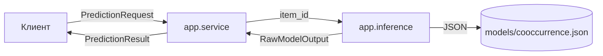
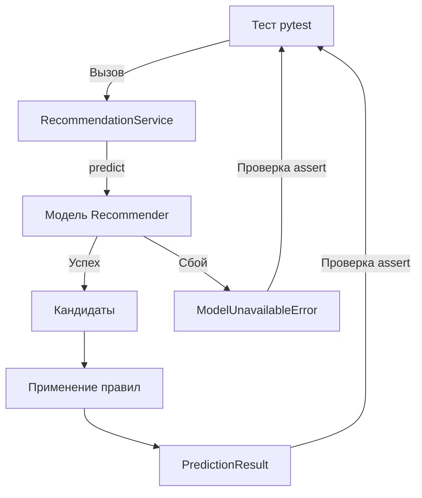

# Лабораторная работа № 3 — отчёт

## 1. Тема проекта и реализованный компонент
**Тема проекта (ЛР № 2):** «Персонализированная рекомендательная система E-Commerce Recommender» (Вариант 8, группа ЕТ-312, Шукшин Егор, Шевяков Александр).

**Реализованный компонент:** `app.services.prediction` — сервис генерации и ранжирования рекомендаций с fallback (резервным вариантом) на популярные товары. Компонент покрывает функциональные требования FR-01 (генерация рекомендаций) и FR-03 (обработка холодного старта).

## 2. Место на архитектурной схеме ЛР № 2
Компонент занимает место между слоем инференса (`app.ml.inference`) и слоем API (`app.api.routes`). Он принимает валидированный `PredictionRequest`, обращается к модели, применяет прикладные бизнес-правила и возвращает `PredictionResult`. 
В рамках данной ЛР веб-сервер (FastAPI) и база данных (PostgreSQL) не реализуются, так как целью является изолированный программный компонент.


## 3. Входной и выходной контракт

**Вход (`PredictionRequest`):**
- `item_id` (строка, ID текущего товара)
- `user_id` (строка, ID пользователя)
- `current_cart_items` (список строк, товары в корзине)

**Выход (`PredictionResult`):**
- `request_id` (UUIDv4 для аудита)
- `user_id`
- `recommendations` (список объектов `{item_id, score}`, где `score` от 0.0 до 1.0)
- `model_version` (версия модели, выдавший прогноз)
- `manual_review_required` (флаг необходимости ручной проверки)

**Ошибки:**
- `pydantic.ValidationError` — неверный вход (пустой ID, неверный тип данных).
- `ModelUnavailableError` — артефакт модели отсутствует или поврежден.

## 4. Используемая модель и источник тестовых данных

**Модель:** Baseline-модель на основе алгоритма **Item-to-Item Co-occurrence** (совместная встречаемость товаров). Модель не использует нейросети и обучается за счет подсчета частот совместных покупок.

**Артефакт:** Веса сохраняются в безопасном формате `models/cooccurrence.json` (без использования pickle).

**Источник данных:** Синтетический мини-датасет (10 пользователей × 1-3 товара), зашитый в скрипт обучения `scripts/train_model.py`. Персональные данные отсутствуют.

## 5. Команда установки зависимостей и локального запуска

```bash
# 1. Создание и активация окружения
python -m venv .venv
source .venv/bin/activate            # Windows: .venv\Scripts\activate

# 2. Установка зависимостей
pip install -r requirements.txt

# 3. Обучение модели (создание models/cooccurrence.json)
python -m scripts.train_model

# 4. Запуск тестов (8 проверок)
python -m pytest -q

# 5. Демонстрация работы
python demo.py
```
## 6. Таблица тестовых случаев и результатов

**Схема прохождения тестового сценария:**


**Сводная таблица результатов:**

| Сценарий | Входные данные | Ожидание | Результат |
|---|---|---|---|
| 1. Валидный запрос | `PROD_PHONE`, `u1` | Корректный ответ со скором 0..1 | PASSED |
| 2. Разные товары | `PROD_PHONE` и `PROD_LAPTOP` | Списки рекомендаций отличаются | PASSED |
| 3. Неверный ввод | Пустой `user_id`, `item_id`, пробелы | Ошибка `ValidationError` | PASSED |
| 4. Fallback | `PROD_UNKNOWN` | Список популярных, `review=False` | PASSED |
| 5. Нет артефакта | Путь к несуществующему файлу | Ошибка `ModelUnavailableError` | PASSED |
| 6. Битый JSON | Файл с невалидным содержимым | Ошибка `ModelUnavailableError` | PASSED |

## 7. Ограничения компонента и ожидаемое развитие на следующих лабораторных

**Ограничения текущего компонента:**
- Модель является baseline (co-occurrence), офлайн-метрики качества (Recall@K, NDCG) не измеряются.
- Синтетический мини-датасет (10 строк) не отражает реальное поведение покупателей.
- Нет воспроизводимого конвейера данных, контейнеризации и CI/CD.
- Отсутствует сквозное логирование (trace_id) и резервный сценарий (fallback) на уровне API.

**План развития:**
1. Переход от синтетического словаря `USER_HISTORY` к полноценному CSV-датасету. Настройка DVC для версионирования данных, валидация контрактов через Pandera и обучение препроцессора (joblib) с защитой от Data Leakage.
2. Обертывание текущего `RecommendationService` в веб-сервис на FastAPI (эндпоинты `/predict` и `/health`). Создание многослойного Dockerfile для запуска сервиса в изолированном контейнере.
3.  Настройка пайплайна GitHub Actions для автоматического прогона тестов, сборки Docker-образа и Smoke-тестирования. Внедрение JSON-логирования с `trace_id` и паттерна Fallback (возврат эвристики при сбое модели). Составление Model Card.

## 8. Изменения архитектуры ЛР № 2

Изменения минимальны и не нарушают исходную архитектуру:

1. В контракт добавлено поле `manual_review_required` для сценариев деградации.
2. Модель из ЛР № 2 (CatBoost + ANN) заменена на baseline co-occurrence для соответствия с ограничением объёма из ТЗ.
3. Поле `device_type` в ЛР № 3 не используется, так как не влияет на логику инференса.
