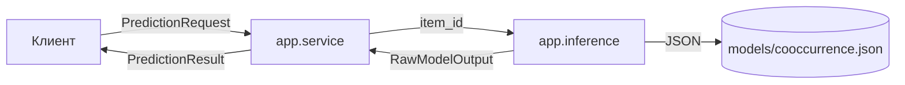

# Лабораторная работа № 3 — отчёт

## 1. Тема проекта и реализованный компонент
**Тема проекта (ЛР № 2):** «Персонализированная рекомендательная система E-Commerce Recommender» (Вариант 8, группа ЕТ-312, Шукшин Егор, Шевяков Александр).

**Реализованный компонент:** `app.services.prediction` — сервис генерации и ранжирования рекомендаций с fallback (резервным вариантом) на популярные товары. Компонент покрывает функциональные требования FR-01 (генерация рекомендаций) и FR-03 (обработка холодного старта).

## 2. Место на архитектурной схеме ЛР № 2
Компонент занимает место между слоем инференса (`app.ml.inference`) и слоем API (`app.api.routes`). Он принимает валидированный `PredictionRequest`, обращается к модели, применяет прикладные бизнес-правила и возвращает `PredictionResult`. 
В рамках данной ЛР веб-сервер (FastAPI) и база данных (PostgreSQL) не реализуются, так как целью является изолированный программный компонент.


## 3. Входной и выходной контракт

**Вход (`PredictionRequest`):**
- `item_id` (строка, ID текущего товара)
- `user_id` (строка, ID пользователя)
- `current_cart_items` (список строк, товары в корзине)

**Выход (`PredictionResult`):**
- `request_id` (UUIDv4 для аудита)
- `user_id`
- `recommendations` (список объектов `{item_id, score}`, где `score` от 0.0 до 1.0)
- `model_version` (версия модели, выдавший прогноз)
- `manual_review_required` (флаг необходимости ручной проверки)

**Ошибки:**
- `pydantic.ValidationError` — неверный вход (пустой ID, неверный тип данных).
- `ModelUnavailableError` — артефакт модели отсутствует или поврежден.

## 4. Используемая модель и источник тестовых данных

**Модель:** Baseline-модель на основе алгоритма **Item-to-Item Co-occurrence** (совместная встречаемость товаров). Модель не использует нейросети и обучается за счет подсчета частот совместных покупок.

**Артефакт:** Веса сохраняются в безопасном формате `models/cooccurrence.json` (без использования pickle).

**Источник данных:** Синтетический мини-датасет (10 пользователей × 1-3 товара), зашитый в скрипт обучения `scripts/train_model.py`. Персональные данные отсутствуют.

## 5. Команда установки зависимостей и локального запуска

```bash
# 1. Создание и активация окружения
python -m venv .venv
source .venv/bin/activate            # Windows: .venv\Scripts\activate

# 2. Установка зависимостей
pip install -r requirements.txt

# 3. Обучение модели (создание models/cooccurrence.json)
python -m scripts.train_model

# 4. Запуск тестов (8 проверок)
python -m pytest -q

# 5. Демонстрация работы
python demo.py
